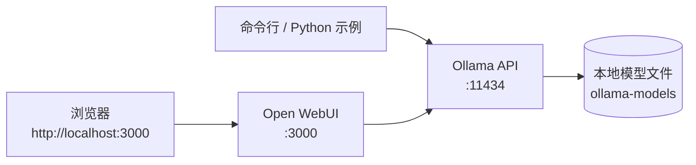

# AI 本地部署实战（Ollama + Open WebUI）

一套可以直接跑起来的**本地大模型部署**方案：模型权重、推理服务、聊天界面全部运行在自己的电脑上，数据不出本机，断网也能用。

- 服务端：[Ollama](https://ollama.com/)（模型管理 + OpenAI 兼容 API）
- 界面：[Open WebUI](https://github.com/open-webui/open-webui)（类 ChatGPT 的网页端）
- 编排：Docker Compose 一键启动，也支持 **Windows 原生安装**（不使用 Docker）



## 这套方案解决什么问题

| 痛点 | 本地部署的做法 |
| --- | --- |
| 隐私数据不敢上传云端 | 提示词、文档、问答记录只存在本机磁盘 |
| 云端 API 按量计费、需要联网 | 一次下载模型，之后零调用成本、可离线 |
| 想换模型 / 调参数 | 一条命令切换 1.5B～32B 的模型，随时改温度、上下文 |
| 业务系统要接大模型 | Ollama 提供 OpenAI 兼容接口，原有 SDK 改一个 `base_url` 即可接入 |

## 三分钟快速开始（Docker，推荐）

前置条件：Windows 10/11 + [Docker Desktop](https://www.docker.com/products/docker-desktop/)（WSL 2 后端），内存 ≥ 16 GB。

```powershell
cd ai-local-deploy
Copy-Item .env.example .env          # 按需修改端口、默认模型
docker compose up -d                 # 拉取镜像并启动 ollama + webui
docker compose exec ollama ollama pull qwen2.5:7b   # 首次拉取模型（约 4.7 GB）
```

启动完成后：

- 聊天界面：<http://localhost:3000>（打开后注册的第一个账号即为管理员）
- 模型 API：<http://localhost:11434>

验证服务是否就绪：

```powershell
curl.exe http://localhost:11434/api/tags
.\scripts\check-env.ps1
```

> 如果执行脚本时报 `running scripts is disabled on this system`，先在当前窗口执行
> `Set-ExecutionPolicy -Scope Process Bypass -Force`，或直接
> `powershell -ExecutionPolicy Bypass -File .\scripts\check-env.ps1`。

## 三分钟快速开始（Windows 原生，不用 Docker）

```powershell
winget install Ollama.Ollama     # 安装 Ollama（已装可跳过）
ollama pull qwen2.5:7b           # 下载模型
ollama run qwen2.5:7b            # 直接对话，/bye 退出
```

原生模式下 Ollama 默认监听 `127.0.0.1:11434`，同样可以用 `examples/chat.py` 调用，只是没有 Web 界面。想加界面可再装 Open WebUI 或直接使用任意 OpenAI 兼容客户端。

## 目录结构

```
ai-local-deploy/
├── README.md                 # 本文件：总览与快速开始
├── docker-compose.yml        # Ollama + Open WebUI 编排
├── .env.example              # 端口、默认模型等配置模板
├── docs/
│   ├── 01-环境准备.md         # 系统、驱动、Docker、代理与磁盘
│   ├── 02-模型选择与量化.md   # 显存估算、量化格式、模型清单
│   ├── 03-部署方案对比.md     # Ollama / LM Studio / llama.cpp / vLLM
│   ├── 04-API与集成.md        # REST 与 OpenAI 兼容接口、流式调用
│   └── 05-常见问题.md         # 启动失败、OOM、GPU 未启用等
├── scripts/
│   ├── check-env.ps1         # 环境自检：内存、磁盘、显卡、端口
│   ├── start.ps1             # 启动服务并等待就绪（Docker / 原生）
│   ├── pull-model.ps1        # 拉取并校验模型
│   └── stop.ps1              # 停止服务，可选清理数据卷
└── examples/
    ├── chat.py               # 流式对话客户端（仅标准库）
    ├── rag_demo.py           # 本地知识库 RAG 最小实现（仅标准库）
    ├── openai_client.py      # 使用 openai SDK 调用本地模型
    └── requirements.txt      # 可选依赖（仅 openai_client.py 需要）
```

## 硬件与模型选型（速查）

| 配置 | 可用内存 / 显存 | 推荐模型 | 体验 |
| --- | --- | --- | --- |
| 办公本（无独显） | 16 GB / 0 | `qwen2.5:1.5b`、`phi3.5:3.8b` | 能跑，速度 5～15 字/秒 |
| 入门独显 | 16 GB / 6～8 GB | `qwen2.5:7b`（Q4）、`llama3.1:8b` | 流畅，日常问答够用 |
| 主流独显 | 32 GB / 12～16 GB | `qwen2.5:14b`、`deepseek-r1:8b` | 写代码、长文总结表现好 |
| 高性能工作站 | 64 GB / 24 GB+ | `qwen2.5:32b`（Q4） | 接近云端中小模型水平 |

显存估算的粗略公式与量化取舍见 [docs/02-模型选择与量化.md](docs/02-模型选择与量化.md)。

## 常用命令

```powershell
.\scripts\check-env.ps1                      # 环境自检
.\scripts\start.ps1 -Mode docker -Model qwen2.5:7b
.\scripts\pull-model.ps1 -Model qwen2.5:14b
docker compose logs -f ollama                # 查看推理服务日志
.\scripts\stop.ps1                           # 停止（保留模型数据）
.\scripts\stop.ps1 -RemoveVolumes            # 停止并删除模型数据
```

## 示例代码

```powershell
# 单轮提问
python examples/chat.py --model qwen2.5:7b --prompt "用三句话解释什么是 RAG"

# 交互式多轮对话（/exit 退出，/reset 清空上下文）
python examples/chat.py --model qwen2.5:7b

# 基于 docs/ 目录的本地知识库问答
ollama pull nomic-embed-text
python examples/rag_demo.py --question "显存 8GB 应该选哪个模型？"

# OpenAI SDK 调用（需 pip install -r examples/requirements.txt）
python examples/openai_client.py --model qwen2.5:7b --prompt "你好"
```

## 安全与合规提示

- 默认只监听本机回环地址；把 `OLLAMA_HOST` 改成 `0.0.0.0` 暴露到局域网前，请确认防火墙与访问控制，Ollama 本身**没有鉴权**。
- Open WebUI 默认关闭登录仅适合本机试用，多人使用请设置 `WEBUI_AUTH=true` 并配置强口令。
- 模型许可证各不相同（Apache-2.0、Llama Community License 等），商用前务必核对模型卡上的授权条款。

## 文档索引

1. [环境准备](docs/01-环境准备.md)
2. [模型选择与量化](docs/02-模型选择与量化.md)
3. [部署方案对比](docs/03-部署方案对比.md)
4. [API 与集成](docs/04-API与集成.md)
5. [常见问题](docs/05-常见问题.md)

## 开源协议

本项目遵循仓库根目录的 [MIT License](../LICENSE)。
